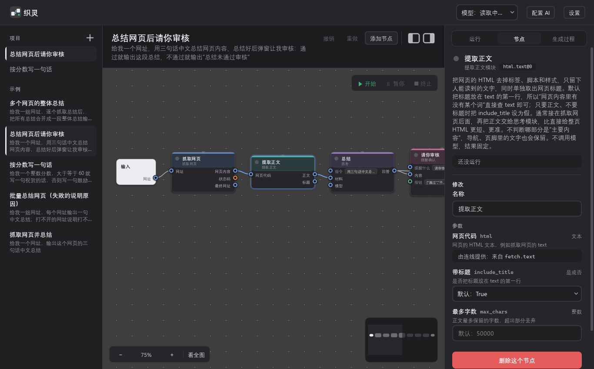

# 织灵

用一句话说清“给什么、要什么”，AI 就从预制的 26 个模块里拼出一张工作流图；图能看、能拖着改、能直接运行——**图本身就是程序**。全部在你自己的电脑上跑，模型可以用本机 Ollama，也可以接 DeepSeek 等云端服务。



## 安装（Windows，需要 Python 3.11 以上）

```powershell
git clone https://github.com/wx0725/zhiling.git
cd zhiling
python -m venv .venv
.\.venv\Scripts\python.exe -m pip install -r requirements.txt
.\.venv\Scripts\python.exe -m native
```

第一次打开会进入引导页：选用云端 AI（填一个 API Key）、用电脑上已装的本地模型，或让织灵检测电脑并帮你装一个合适的模型；也可以先跳过 AI 直接手动搭。

**需要准备什么**
- 本地模型：装 [Ollama](https://ollama.com)，引导页会按你的显卡推荐并下载模型（工作流里的“思考”节点也用它）；
- 或云端模型：在引导页填任一提供方的 API Key（DeepSeek、Kimi、智谱、通义千问、豆包、OpenAI、Claude、Gemini 等，密钥存进系统凭据管理器）。
- 运行会读或改电脑上文件的工作流时，织灵会先列出来让你确认；抓取网页默认不访问本机和内网地址（需要时在 `model_settings.json` 里写 `"allow_local_fetch": true`）。

想做成双击即开的程序：`.\.venv\Scripts\python.exe -m PyInstaller native\launcher.spec --noconfirm --distpath native\dist --workpath native\build`，得到 `native\dist\织灵.exe`（它只是启动器，仍用项目目录里的代码和 `.venv`）。

## 桌面程序（原生界面）

`python -m native`（或打包后的 `native\dist\织灵.exe`）打开原生桌面窗口（PySide6 / Qt 控件，底层没有任何浏览器内核）。
它在程序内部启动后端接口（只监听本机、端口每次随机，只给这个窗口用），如果 `model_settings.json` 里要求由本程序启动某个 Ollama 服务，会先把它拉起来；关闭窗口即停止后端（Ollama 留在后台）。
后端启动失败时窗口里会显示原因，详细输出在 `native\server.log`。界面的展开收起等设置记在本机（Windows 注册表）。

- 画布右上角有“开始、暂停、终止”：开始按右侧运行页填好的输入运行；暂停在正在运行的节点跑完后生效，之后可以继续；终止立即结束正在运行的节点。运行阶段由 `Controller.run_state()` 给出（idle / running / pausing / paused / stopping / done / error / stopped）
- 也可以直接运行：`.\.venv\Scripts\python.exe -m native`
- 代码在 `native\`：`controller.py`（全部状态和操作）、`canvas\`（画布、节点、连线、循环框）、`side\`（顶栏、项目栏、开始页、画布标题行）、`panels\`（右侧面板）、`onboarding\`（首次启动引导）、`settings.py`（设置面板）、`pet\`（桌宠）、`logic\`（排版、编辑、防重叠等纯计算，从网页版移植）
- `织灵.exe` 只是启动器：用项目的 `.venv` 运行 `python -m native`，界面和后端都从项目目录读取，改了代码重开窗口即生效。换图标或启动方式时重新打包：`.\.venv\Scripts\python.exe -m PyInstaller native\launcher.spec --noconfirm --distpath native\dist --workpath native\build`
- 测试：`$env:QT_QPA_PLATFORM='offscreen'; .\.venv\Scripts\python.exe -m unittest discover -s . -t . -p "test*.py"`（`tests\test_native_*.py`）

旧的网页界面（下一节）和 Tauri 窗口（`desktop\`）暂时保留，新版稳定后再删。

## 网页

也可以双击 `启动网页.cmd`，在浏览器里打开 http://127.0.0.1:8790 （只有本机能访问；关闭那个窗口即停止）。
同样会先启动 `model_settings.json` 里要求启动的 Ollama 服务。

- 开始页（没打开工作流时）：写下想法后点“帮我理清需求”，顺着这句话追问，直到“标准需求单”没有缺项（见下面“理清需求与统一模型协议”）。页面上有需求卡片（给什么、要什么、怎么做、特殊情况、例子）、“还缺什么”清单和这一轮的问题（每轮最多 3 个，每个有几个选项，最后一个“其他”可以自己写，问题下写明为什么问）；做不到的部分会问你去掉继续还是不做了。任何时候都可以“按这个需求生成”，没说的部分按常规处理并写进需求。也可以从示例开始，或“新建空白工作流”自己搭（画布右上角有分步清单）
- 顶栏的下拉框选生成用的模型，理清需求、生成、实跑审查都用它。没打开项目时改的是默认模型；打开着项目时改的只是**这个项目**用的模型（记在项目里，每个项目可以不同，新项目一开始跟着默认）。顶栏“设置”里有三栏：桌宠（关主窗口时有工作流在运行要不要转到后台并显示桌宠）、杂项（生成后实跑检查、重新配置 AI）、自定义（“思考”模块默认用的本地模型、自己添加 OpenAI 兼容的云端服务商，存进 `model_settings.json`）。本地的是电脑上 Ollama 已装的模型（自动读取）；云端 API（DeepSeek、智谱、小米 MiMo、豆包、通义千问、Grok、Gemini、OpenAI、Claude、Kimi 等，密钥从环境变量读，变量名见 `config/providers.json`）；或电脑上已登录的订阅命令行（Kimi Code、Codex、Claude Code、Gemini CLI）。还不能用的灰着，悬停看还差什么
- 在首页“你想让它做什么？”里写需求，点“直接生成”（或先“帮我理清需求”）；右侧“生成过程”显示每一轮的起草、校验和运行检查，画布随每一版更新，画布标题行有“停止生成”
- 运行：在右侧按输入类型填写后点“运行”（工作流里有“写入文件”时先弹窗确认）；节点上的灯显示状态（绿＝完成，空心＝跳过，红＝出错，琥珀闪烁＝运行中），信号走过的连线加深
- 点节点查看它做什么、每次收到的输入和产生的输出；通过检查的生成结果可以保存到“我保存的”
- 链接可直接打开某个工作流：`http://127.0.0.1:8790/?wf=examples/score_message.workflow.json`

在画布上编辑（改的就是程序本身，右侧“程序”页签实时显示 JSON）：
- 改参数：点节点，在右侧“修改”里填固定值或改名称；留空表示用默认值；接了线的输入显示来源
- 连线：从节点右侧的输出插孔拖到另一个节点左侧的输入插孔；接到已有来源的输入会替换旧线。从条件分支的 then / else 拖到节点顶部是控制线
- 增删：“添加节点”加模块、条件分支、合并或逐项循环（选中循环时加进循环里）；选中节点或连线按 Delete 删除
- 工作流自己的输入、输出：点画布上的“输入”“输出”端点，可增删、改名字（连线跟着改）、类型、说明、默认值；不选节点时可改工作流名称和说明
- 拖动节点位置会记在程序的 layout 里（只影响显示）。节点之间不会重叠：拖动时撞上别的节点会贴着边滑，放下时压着别人会挪到最近的空位；把框外的一个节点拖到循环框上，框会亮起“松手放进这个循环”，松手就放进框里（连着它的线断开，要在框里重新连）；框里的节点在右侧“节点”页点“移出循环框”挪回外面。循环框里的节点拖到边上，框会跟着扩大并推开旁边的节点；框里的节点往里收时框也跟着回缩（`web/src/collide.js`）。循环框四角和四边中点有拉伸点，拉大后框保持这个大小、不再自动回缩（方便往里放新节点），往里拉压到框里节点时停住；拉回正好装下的大小即恢复自动伸缩。连线可以和节点、连线交叠；Ctrl+Z 撤销，Ctrl+Shift+Z 重做
- 每次修改后自动校验，问题标在图上；“我保存的”工作流点“保存”写回原文件，示例和生成的另存到“我保存的”
- 测试：`cd web`，`npm test`（单元）、`npx vite build` 后 `npm run e2e`（真实浏览器操作）

前端开发：`cd web`，`npm run dev`（端口 5173，接口转给 8790）；改完运行 `npx vite build`；`node scripts/shot.mjs <网址> <输出.png>` 可截全尺寸图自查。

## 理清需求与统一模型协议

原则：模型只用来理解语义，能用代码判断的都由代码做，减轻模型的负担和消耗。

- 统一模型协议（`tools/protocol.py`）：本地 Ollama、云端 API、订阅命令行都收同一种请求（任务名、说明、内容、要不要 JSON、回答形状的代码检查），回同一种结果（是否成功、解析好的数据、原始文字、错误、来源、用时、调用次数）。取出 JSON、检查形状、不合格时带着具体原因再问一次、统计调用次数都在这里统一做；各来源的差别只在 `tools/llm.py`。
- 标准需求单（`tools/spec.py`）：输入、输出（名字、类型、说明）、步骤（对应哪个模块、是否逐项）、条件分支（否则怎么办）、特殊情况（会失败的步骤失败时怎么办）、例子（选填）、做不到的部分。模型（`tools/refine.py`）只把使用者的话读成这张单子，没说清的留空、不猜。
- 由代码决定的：类型和模块是否合法、缺哪一栏、按标准流程的顺序问什么、每轮最多问几个、问过的不再问；会失败的模块（类别为“获取”的，如抓取网页、读取文件）有没有说失败怎么办；有分支有没有说“否则”；输入是一组时结果要逐项还是合并。代码给的选项点了直接改单子，这一轮不调用模型；自己写的回答或改过的卡片才交给模型重读，重读后代码写进去的决定照样保留。交给生成的需求文字也由代码拼。
- 生成时（`/api/generate` 带上需求单）：有做不到的部分且没同意去掉，代码直接拒绝；否则不再让模型判断能不能做；生成的图输入输出类型和单子对不上时由代码指出来让它改；`spec`、`intent` 这类固定字段由代码填。
- 评测：`python -m evals.run_generation --model ... --check --spec` 先把题目当作第一句话理清成需求单（不回答追问）再生成，每道题记下模型调用次数。

## 目录

| 路径 | 内容 |
|---|---|
| `docs/接口规范.md` | 模块描述、工作流图、运行语义、校验规则。**先读这个** |
| `schemas/` | 工作流图与模块描述的 JSON Schema |
| `core/` | 类型规则、模块注册表、校验器、执行引擎 |
| `modules/` | 模块（26 个）。获取：读取文件、读取表格、读取Word、列出文件、抓取网页、当前时间、读剪贴板；思考：`llm.think`；逻辑：比较；处理：取字段、提取正文、筛选列表、排序列表、列表统计、查找匹配、替换文字、转成文字、转成数字、转数字列表、合成文字、拆分文字；交互：提醒确认（弹窗提醒、待办勾选、审核通过/不通过，等你回答再继续）；输出：写入文件、写入表格、移动文件、写剪贴板。每个模块一个文件夹：`module.json` 描述 + `module.py` 实现 + `test_module.py` 测试 |
| `examples/` | 示例工作流：单页总结、批量总结（foreach + if + merge）、按分数写一句话（控制线）、多网页整体总结（text.join）；`teach/` 为生成器教学例子 |
| `tools/` | 命令行：校验（validate）、运行（run）、一句话生成（generate）、运行检查（semantic）、网页服务（serve）、一键启动（start.ps1）；理清需求（refine）、标准需求单（spec）、统一模型协议（protocol）、模型接入（llm） |
| `server/` | 网页服务接口：工作流列表与保存、校验、流式生成、流式运行 |
| `web/` | 网页前端（React + React Flow） |
| `evals/` | 生成器测试题（27 道）、结果与复查工具；`fixtures/` 是题目用的本地示例网页和文件（跑题库时在 8799 端口提供网页） |
| `outputs/` | “写入文件”模块用相对路径保存时的位置（不进 git） |
| `tests/` | 校验器、执行引擎、运行检查、网页服务的测试 |

## 命令行

```powershell
python -m venv .venv
.\.venv\Scripts\python.exe -m pip install -r requirements.txt
.\.venv\Scripts\python.exe -m tools.validate                      # 校验全部模块与示例
.\.venv\Scripts\python.exe -m unittest discover -s . -t . -p "test*.py"
.\.venv\Scripts\python.exe -m tools.run examples\score_message.workflow.json score=85     # 运行工作流，记录写入 runs/
.\.venv\Scripts\python.exe -m tools.run examples\summarize_many.workflow.json urls=@urls.json  # 列表等复杂输入从 JSON 文件读取
.\.venv\Scripts\python.exe -m tools.generate "给我一个网址，用一句话总结" --check --out new.workflow.json
```

`llm.think` 使用本机 Ollama（模型见下面“模型设置”，地址也可用 `WORKFLOW_OLLAMA_URL` 改）；生成器的服务地址用 `WORKFLOW_GEN_URL` 单独设置。命令行里用云端模型生成：`--model api://deepseek/deepseek-flash`、`--model cli://kimi`（见 `tools/llm.py`）。

## 模型设置

代码里不写任何个人配置，换一台电脑装好就能用：
- 默认找本机的 Ollama（地址取环境变量 `OLLAMA_HOST`，没有就是 `127.0.0.1:11434`），装了哪些模型就列哪些；一个能用的模型都没有时，生成会提示怎么办。
- 云端提供方的接口地址和密钥变量名在 `config/providers.json`；设好对应的环境变量就能选。
- 每台电脑自己的设置放在 `model_settings.json`（不进 git），照 `model_settings.example.json` 写，每项都可省略：`model` 选了哪个、`think_model` “思考”模块默认用的模型（不写就用已装的第一个）、`ollama` 另外的 Ollama 服务（带 `start` 的由本程序按里面的环境变量启动，例如模型放在别的盘）、`apis` / `clis` 自己添的提供方。

## 新增模块

1. 新建 `modules/<名称>/`，写 `module.json`（字段见规范第 3 节，至少一个 example）、`module.py`（`run(inputs) -> dict`）、`test_module.py`。每个输入、输出都写一个 `label`（2–4 个字的中文短名，如“网址”“状态码”），画布上的插孔显示的就是它。
2. 运行 `python -m tools.validate`，模块描述必须通过。
3. 会写文件或产生外部影响的模块：`side_effects` 写 `write`，并在 `runtime.dry_run` 提供演练函数（不改动任何东西、返回同样形状的结果），生成时的运行检查用它；网页上运行这类工作流前会弹窗确认。
4. 要停下来问使用者的模块：`interaction` 写 `ask`，并声明一个 `answer` 输入（`object`，默认 `{}`）。引擎运行到它时先发 `ask` 事件（带除 answer 外的全部参数），界面弹出提示窗，使用者的回答通过 `POST /api/run/{run_id}/answer` 送回后填进 `answer` 再运行模块；命令行和运行检查里没人可问，`answer` 为空，模块自己决定默认回答。

## 后续步骤

1. 画布编辑的下一步：把当前的图作为起点，让模型按一句修改意见改图
2. 继续扩充模块库与测试题（已有 26 个模块、27 题，27B 生成加运行检查 27/27）；积累经过运行验证的“需求 → 图”样例后再考虑微调专用模型
3. 打磨界面与体验

## 许可证

MIT，见 `LICENSE`。
